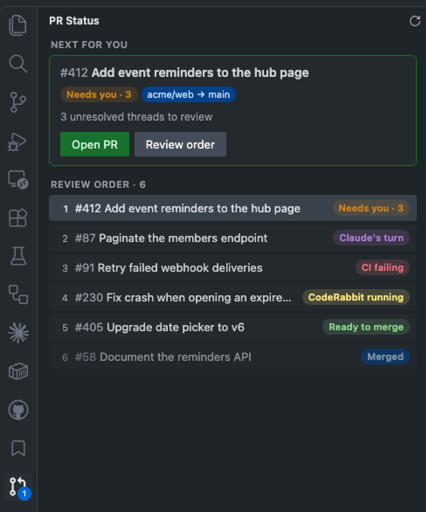

# PR Review Loop

A sidebar that shows your pull requests in review order and whose turn it is, live from the `pr-status.json` written by the `resolving-pr-review-comments` Claude Code skill.



## What it shows

- **Next for you**: a card with the PR that needs your action now.
- **Review order**: every PR in the order to handle them, each with a status pill.
- **Local changes**: a pill on a PR when its branch has uncommitted or unpushed work in a local clone.
- **Counts**: an activity-bar badge and a status-bar item with the number of PRs waiting on you.
- **Auto refresh**: the extension runs the skill's script on a timer and also watches `pr-status.json`, so the panel updates when Claude rewrites it.

## Requirements

- [`gh`](https://cli.github.com/), logged in (`gh auth login`)
- [`jq`](https://jqlang.github.io/jq/)
- The `pr-review-loop` Claude Code plugin. Run the **PR Status: Install Claude Code skill** command, or install it yourself:

```
claude plugin marketplace add baruchiro/skills && claude plugin install pr-review-loop@skills
```

If the installed skill is too old to write JSON, the panel shows an error telling you to update it (`claude plugin install pr-review-loop@skills`).

## How the file is found

The extension looks for `pr-status.json` in the folder of the `.code-workspace` file first, then in each workspace folder. The sidebar appears once a file exists.

## Local changes

A PR gets the pill when a local git repository whose GitHub remote matches the PR's repo (ssh and https, case-insensitive) has either:

- uncommitted files while the PR's head branch is checked out, or
- unpushed commits on the PR's head branch.

Limits: only repositories open in VS Code are checked, only GitHub remotes match, and PRs from older skill output without `headRefName` are skipped.

## Settings

| Setting | Default | Description |
| --- | --- | --- |
| `prStatus.refreshIntervalSeconds` | `300` | Seconds between automatic refreshes. `0` turns it off. |
| `prStatus.scriptPath` | `""` | Absolute path to `pr-status.sh`. Empty auto-discovers the installed skill. Machine-scoped: set it in user settings only; workspace settings are ignored. |

## Workspace Trust

In an untrusted workspace, auto refresh and **PR Status: Refresh** are off, and `prStatus.scriptPath` is ignored. The panel still shows an existing `pr-status.json`. Trust the workspace to enable refreshing.

## Links

Skill and plugin: https://github.com/baruchiro/skills
